# IT Support Helpdesk System
## Smart Telegram Ticketing & Centralized IT Web Dashboard
### Executive Sales Presentation & Technical Proposal

---

## 🎯 Executive Summary | نبذة عن النظام

نظام **IT Support Helpdesk** هو حل متكامل وشامل لإدارة طلبات الدعم الفني في الشركات والمؤسسات، يجمع بين:
1. **سهولة تواصل الموظفين الفائقة**: عبر تطبيق **Telegram** المتاح على هواتف وأجهزة جميع الموظفين دون الحاجة لتحميل تطبيقات جديدة أو ملء استمارات ويب معقدة.
2. **لوحة تحكم إدارية احترافية لفريق الـ IT (Web Dashboard)**: متوافقة مع معايير الـ ITIL العالمية، تدعم التحديث اللحظي (WebSockets)، وحساب اتفاقيات مستوى الخدمة (SLA)، وتوزيع المهام، والتقارير المتقدمة.

---

## 🚨 لماذا تحتاج شركتك إلى هذا النظام؟ (The Problem vs Solution)

```mermaid
flowchart TD
    subgraph OldWay["❌ الوضع التقليدي الشائع"]
        A1["مكالمات ورسائل واتساب عشوائية"] --> A2["ضياع المشاكل ونسيانها"]
        A2 --> A3["لا توجد معرفة بمن استلم المشكلة"]
        A3 --> A4["تأخر الحلول وغضب الموظفين والإدارة"]
    end

    subgraph NewWay["✅ نظام IT Support Helpdesk"]
        B1["رسالة واحدة على تيليجرام"] --> B2["فتح تذكرة فورية وربط الهاتف والتصنيف"]
        B2 --> B3["تنبيه فوري لجروب الـ IT واستلام بالاسم"]
        B3 --> B4["عداد SLA زمني وتنبيهات كسر الوقت"]
        B4 --> B5["حل المشكلة + تقييم بالنجوم من الموظف"]
    end
```



| المشكلة الحالية | الحل الذكي في هذا النظام |
| :--- | :--- |
| **رسائل واتساب ومكالمات ضائعة** بين الموظفين وفريق الـ IT. | **تذكرة موثقة برقم كودي فريد (e.g. #TK-1008)** لكل مشكلة مع حفظ سجل المحادثات كاملاً. |
| **عدم معرفة الفني المسؤول** عن حل العطل وتكرار السؤال. | **نظام الإسناد الفوري (Assignment & Claim)** بنقرة واحدة من تيليجرام أو الداش بورد. |
| **تأخر الحلول** لعدم وجود إطار زمني محدد للمشاكل. | **نظام SLA ذكي** يحسب دقائق الحل المتبقية ويرسل تحذيرات تلقائية قبل كسر المهلة. |
| **عدم وجود تقييم لجودة خدمة الدعم الفني**. | **استبيان رضا تلقائي بنجوم (1-5 ⭐)** يرسله البوت فور إنهاء المشكلة. |
| **انعدام الإحصائيات** لمعرفة الأعطال الأكثر تكراراً وأداء الفنيين. | **تقارير دورية وإحصائيات فورية** مع إمكانية التصدير إلى ملفات **Excel / CSV**. |

---

## 💎 المميزات الرئيسية للنظام (Core Features)

### 1. تجربة المستخدم والموظف (Telegram Bot Integration)
- **فتح التذاكر التلقائي**: بمجرد كتابة الموظف لمشكلته (أو إرسال صورة/سكرين شوت للعطل)، يقوم البوت بفتح التذكرة فوراً وتصنيفها تلقائياً (Network, Hardware, Software, Email, Printers, ERP).
- **التواصل الخاص والآمن (Privacy First)**: حتى لو كتب الموظف مشكلته في جروب عام، فإن جميع ردود فريق الـ IT ومتابعاتها تصل للموظف **في المحادثة الخاصة 1-on-1** منعاً للإزعاج وحفظاً لخصوصية البيانات وكلمات المرور.
- **سحب وتسجيل رقم الهاتف تلقائياً**: إمكانية مشاركة رقم الهاتف بنقرة واحدة عبر زر `📱 Share Phone Number` أو التعرف عليه تلقائياً إذا كُتب داخل الرسالة.
- **حل المشكلات الذكي وقاعدة المعرفة (FAQ Auto-Resolution)**: يقترح البوت حلولاً فورية للأسئلة الشائعة (مثل استعادة كلمة المرور، أو إعدادات الواي فاي) لحل المشكلة ذاتياً دون إشغال مهندس الـ IT.
- **استبيان الرضا بعد الحل (CSAT 5-Star Rating)**: عند إغلاق التذكرة، يرسل البوت استبياناً مصمماً ومختصراً بالنجوم من 1 إلى 5 ليقيم الموظف سرعة وكفاءة الدعم.

### 2. لوحة تحكم فريق الدعم الفني (Web Dashboard)
- **تحديثات حية لحظية (Live Real-time via WebSockets)**: ظهور التذاكر والرسائل والتقييمات الجديدة فوراً مع تنبيه صوتي دون الحاجة لعمل Refresh للصفحة.
- **إدارة دورة حياة التذكرة الصارمة**:
  - لا يمكن إغلاق التذكرة إلا إذا كانت **مسندة لفني محدد** (`Assigned To`).
  - لا يمكن إغلاق التذكرة إلا بكتابة **رسالة الحل** (`Resolution Note`) التي توضح للموظف ما تم إنجازه.
- **قوالب الردود السريعة (Canned Responses)**: قوالب جاهزة قابلة للتخصيص للرد على الاستفسارات المتكررة بضغطة زر.
- **تنبيهات واستلام المهام عبر جروب التيليجرام**: زر `🙋‍♂️ Claim Ticket` داخل جروب الـ IT يتيح للمهندس استلام التذكرة من هاتفه مباشرة وهو في الموقع.
- **ملاحظات الفريق الداخلية (Internal Notes)**: إمكانية كتابة ملاحظات وتوجيهات بين الفنيين داخل التذكرة لا يراها العميل.

---

## 🛠️ خيارات الاستضافة والتنفيذ (Deployment Models)

نظام **IT Support Helpdesk** مرن للغاية ومصمم ليعمل بأحد الخيارين التاليين حسب رغبة الشركة وطبيعة بنيتها التحتية:

### الخيار الأول: التثبيت الداخلي (On-Premises / Local Server)
> مناسب للشركات التي ترغب في تشغيل النظام محلياً داخل شبكتها الداخلية دون أي اشتراكات خارجية.

- **كيف يعمل؟**:
  - يتم تثبيت البرنامج عبر ملف Setup مستقل جاهز (`ITSupportHelpdesk_Setup_v2.0.exe`) على أي جهاز كمبيوتر أو **Windows Server** موجود في مقر الشركة.
  - يعمل كخدمة خلفية صامتة (Background Service) تبدأ تلقائياً مع تشغيل الويندوز دون أي شاشات سوداء.
  - يفتح لوحة التحكم على الشبكة الداخلية (مثل: `http://192.168.1.50:8080`).
- **المتطلبات التقنية**:
  - جهاز كمبيوتر عادي أو سيرفر بنظام Windows (Windows 10 / 11 أو Windows Server 2016/2019/2022).
  - معالج ثنائي النواة (Dual Core) ورامات 4GB أو أكثر.
  - اتصال إنترنت مستمر لربط بوت التيليجرام.
  - تشغيل الجهاز 24/7 (أو خلال ساعات العمل الرسمية).
- **التكلفة الشهرية للاستضافة**: **$0 (صفر دولار - مجاناً تماماً)** لأن السيرفر ملك للشركة.

---

### الخيار الثاني: الاستضافة السحابية (Cloud Host / VPS)
> مناسب للشركات التي تملك فروعاً متعددة أو موظفين يعملون عن بُعد، وترغب في ضمان تشغيل 24/7 دون الاعتماد على كهرباء أو إنترنت المكتب.

- **كيف يعمل؟**:
  - يتم تشغيل النظام على سيرفر سحابي خاص (Cloud VPS) بنظام Linux أو Windows.
  - يُربط بدومين خاص بالشركة مع شهادة حماية مشفرة (مثل: `https://helpdesk.company.com`).
  - متاح للمسؤولين وفريق الـ IT من أي مكان بالعالم وفي أي وقت عبر المتصفح أو الهاتف.
- **المتطلبات التقنية**:
  - سيرفر سحابي اقتصادي (Cloud VPS): معالج 1 أو 2 vCPU مع رامات 2GB ومساحة تخزين SSD 20GB.
  - اسم نطاق فرعي (Subdomain) تابع للشركة.
- **التكلفة الشهرية للاستضافة السحابية**:
  - سيرفر سحابي على (Hetzner أو DigitalOcean أو Hostinger): **حوالي $4 إلى $6 شهرياً فقط**.
  - شهادة الأمان SSL: **مجانية مدى الحياة** (Let's Encrypt).

---

## 💰 دراسة التكاليف ومقارنة العائد على الاستثمار (Pricing & ROI Comparison)

### مقارنة مع الحلول السحابية العالمية الشائعة:
| المعيار | الأنظمة العالمية (Zendesk / Jira / Freshdesk) | نظام IT Support Helpdesk |
| :--- | :--- | :--- |
| **طريقة التسعير** | اشتراك شهري لكل موظف دعم فني ($30 - $70 / فني / شهرياً). | **ملكية كاملة للبرنامج بدون أي اشتراكات لكل فني**. |
| **تكلفة فريق مكون من 5 فنيين سنوياً** | $1,800 إلى $4,200 سنوياً. | **تكلفة إعداد رمزية لمرة واحدة فقط**. |
| **سهولة الاستخدام للموظفين** | تتطلب حسابات وكلمات سر ودخول لموقع ويب. | **بنقرة واحدة على Telegram الموجود معهم بالفعل**. |
| **خصوصية وسرية البيانات** | البيانات مخزنة على خوادم شركات خارجية. | **قاعدة البيانات ملكك بنسبة 100% (On-Premise أو سيرفرك)**. |

---

## 🏷️ مقترح باقات البيع للشركات (Commercial Packages Proposal)

يمكنك عرض المشروع على الشركات بأحد النموذجين التاليين:

### الباقة 1: رخصة الشراء لمرة واحدة (One-Time Turnkey License)
* **المستهدف**: الشركات التي ترغب في شراء النظام بالكامل والتثبيت على سيرفرها الداخلي.
* **ما يشمله العرض**:
  1. تثبيت النسخة النظيفة الكاملة للبرنامج وتشغيلها كخدمة دائمة.
  2. إنشاء وتخصيص بوت تيليجرام خاص بالشركة باسمها ولوجو الشركة.
  3. ربط وتدريب فريق الـ IT على استخدام الداش بورد وإدارة التذاكر وتصدير التقارير.
  4. ضمان ودعم فني مجاني لمدة (3 أشهر إلى 6 أشهر).
* **السعر المقترح**: **$400 إلى $800** (أو ما يعادله بالعملة المحلية حسب حجم الشركة).

---

### الباقة 2: الإدارة السحابية كخدمة (Managed SaaS / Monthly Retainer)
* **المستهدف**: الشركات التي لا ترغب في إدارة سيرفرات وتريد حلاً سحابياً متكاملاً جاهزاً للعمل.
* **ما يشمله العرض**:
  1. حجز واستضافة السيرفر السحابي وشهادة الـ SSL والدومين الخاص.
  2. المراقبة الدورية للخدمة وضمان تشغيلها بنسبة 99.9%.
  3. أخذ نسخ احتياطية دورية لقاعدة البيانات (Backups).
  4. الدعم الفني والتحديثات المستمرة.
* **السعر المقترح**:
  - رسوم تأسيس أولية (Setup): **$150**.
  - اشتراك شهري شامل الاستضافة والدعم: **$35 إلى $50 شهرياً**.

---

## 🚀 خطوات تسليم العميل الجديد (New Client Onboarding in 15 Minutes)

لتسليم النظام لأي عميل جديد بنسخة نظيفة تماماً بدون أي داتا سابقة:

1. **تشغيل سكربت النسخة النظيفة**:
   ```bash
   python reset_to_clean_state.py
   ```
   يقوم هذا السكربت بمسح كافة تذاكر التجارب وتفريغ التوكن، ووضع قاعدة بيانات جديدة ونظيفة تحتوي فقط على:
   - حساب المسؤول الافتراضي (`admin` / `admin123`).
   - قوالب الردود السريعة والأسئلة الشائعة باللغة الإنجليزية.
   - 0 تذاكر، 0 رسائل، 0 بروفايلات.

2. **إنشاء بوت تيليجرام للعميل**:
   - من حساب العميل، فتح [@BotFather](https://t.me/BotFather) وإرسال أمر `/newbot`.
   - كتابة اسم البوت واليوزرنيم المطلوب للشركة (مثل: `Company_ITSupport_bot`).
   - نسخ الـ API Token.

3. **إعداد جروب الـ IT وتفعيل التنبيهات**:
   - عمل جروب على تيليجرام لفريق الـ IT وإضافة البوت فيه كـ Admin.
   - تشغيل النظام وفتح الداش بورد `http://localhost:8080`.
   - تظهر نافذة التثبيت فوراً لإدخال توكن البوت والـ Group ID والبدء في استقبال التذاكر!
